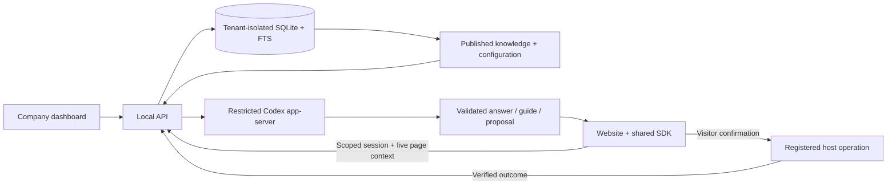

# GuideKit

A visual AI assistant platform for websites. Configure an agent with company knowledge, publish a version, and install the same browser SDK on your website. Visitors can ask questions, follow live highlights, and approve explicitly registered actions.

The core runs locally and uses the developer's signed-in ChatGPT subscription through official Codex app-server. No model API key, credential extraction, or paid fallback is used. Public source does not expose your personal runtime as a hosted service.

## Run

Requires Node.js 24+, npm, and a current [Codex installation](https://learn.chatgpt.com/docs/cli).

```bash
npm ci --ignore-scripts
codex login
npm run build
npm start
```

Open http://127.0.0.1:4410 and create your own workspace. No owner account or password is shipped. Login and company data persist in the ignored `.data/` directory. The runtime selects the signed-in account's catalog default; an explicit `GUIDEKIT_MODEL` override must be available to that account. A successful sign-in is not a completed inference; runtime status distinguishes the two.

1. Create an agent and choose CRM or support capabilities.
2. Add your own `.txt`/`.md` knowledge or explicitly load an example document.
3. Save and publish the agent.
4. Open the CRM or support website from Install. Its URL carries only the public agent ID.
5. Ask how to do something, or request a supported action. Review its details and approve it.

CRM: http://127.0.0.1:4411. Support: http://127.0.0.1:4412. These are separate browser origins using the identical SDK. Their synthetic contact/request records persist in browser storage. They do not connect a private CRM or send email.

```bash
# UI development: Vite on 4413, API and demo sites on 4410–4412
npm run dev
```

Configuration is described in `.env.example`; pass overrides as environment variables. Default ports should stay unchanged for the bundled demo links. `GUIDEKIT_DATA_DIR` chooses a separate data directory; back up that entire directory while the app is stopped. Do not upload it to GitHub. The personal runtime deliberately binds only to loopback.

## Install on a website

Publish an agent with your website's exact origin allowed, then copy its installation snippet:

```html
<script
  src="http://127.0.0.1:4410/sdk/guidekit.js"
  data-agent-id="YOUR_PUBLISHED_AGENT_ID"
  data-endpoint="http://127.0.0.1:4410"
  defer
></script>
```

This core supports local HTTP website testing. HTTPS websites require an HTTPS SDK/runtime endpoint and an appropriate deployment/identity design; do not expose a personal subscription bridge to the internet.

The hotkey is **Cmd/Ctrl + Shift + K**. The SDK reads bounded accessible labels, excludes private controls, strips query/hash parameters, and never captures a whole-page screenshot. Add `data-guidekit-id="stable-control-id"` to important controls and `data-guidekit-private` to sensitive areas. Basic answers and guidance can use discovered controls. Reliable business operations require host-registered actions.

For actions, use the [SDK API](packages/sdk/README.md) and the complete [CRM host example](apps/demo/host.js). The host owns its authorization, validates arguments, respects cancellation and idempotency, and verifies the business result. GuideKit requires confirmation and records the reported outcome. The ESM build is available at `/sdk/guidekit.mjs`.

## Architecture



Knowledge retrieval supplies context; it does not fine-tune a model. Published versions snapshot their documents/configuration and existing sessions stay pinned. Draft edits require republishing to affect new sessions.

## Verify

```bash
npm run typecheck
npm test
npm run build
npm run audit:secrets
npm audit --audit-level=high
```

Unit and HTTP contract tests use explicitly isolated test providers; the production app never falls back to those providers. Browser and live-model verification status is recorded in [docs/status.md](docs/status.md). Build success alone is not evidence of working voice, model access, a hosted deployment, or production readiness.

CI installs locked dependencies through [Socket Firewall Free](https://docs.socket.dev/docs/socket-firewall-free), runs advisory/secret checks, and executes the core checks. Actions are pinned to immutable commits; Dependabot proposes updates. The optional Socket GitHub App has not been installed.

## Scope and next integrations

Core: authenticated developer workspaces, company-scoped knowledge, publishing, shared browser SDK, citations, live highlights, approved registered actions, persisted run outcomes, and browser-native dictation/read-aloud controls. Speech depends on browser support and microphone permission; no microphone audio verification is claimed unless recorded in status.

Cutroom is a separate demonstration host. Its integration must use its command/revision and permission boundary; no editor runtime data or media belongs in this repository. A dedicated adapter is a next integration checkpoint after the core proof.

TigerGraph workflow relationships and Wispr's approved embedded voice API remain optional follow-on work. Billing, teams/SSO, native apps, arbitrary-site automation, and a hosted commercial inference service are outside this local core. The SDK cannot bypass a host's permissions or access cross-origin iframe/canvas semantics automatically.

See [product](docs/product.md), [architecture](docs/architecture.md), [API contracts](docs/contracts.md), [security](docs/security.md), and [runtime details](packages/runtime/README.md). MIT licensed.
