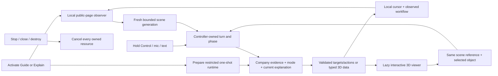

# Active Guide and Explain module

Requested and scoped on 2026-11-14. GuideKit remains a website SDK; this module observes bounded public controls in the integrated page. It does not capture the desktop, private fields, cross-origin frames, arbitrary canvas contents or every pixel of the screen.

## Intended experience

1. Open GuideKit and choose **Guide me** or **Explain**. This starts an explicit active session, prepares a restricted model connection and observes the public page locally. It starts no microphone or model turn by itself.
2. Hold Control to talk. Release to finalize and submit once. Ordinary Control shortcuts, Control-click, composition, blur and Escape remain safe. The existing keyboard shortcut, microphone button and text input remain usable.
3. Show truthful starting/listening/finalizing/thinking/presenting states under one controller-owned turn generation. An interrupted old operation cannot clear a newer state.
4. Guide follows real actions through grounded steps, scrolls when necessary and reacts locally. Only a relevant unsupported branch needs new model reasoning. Pause, chat, voice interruption and resumption retain the active goal deliberately; Stop ends observation, speech, work and presentation.
5. Explain answers the selected subject. A request for a model produces a labelled interactive 3D explanation. The visitor can orbit, zoom, select an object and reset the view. Follow-ups such as “show the engine” update the same scene and preserve the camera unless focus or a new subject was requested.
6. The 3D model is a conceptual procedural illustration, not a CAD asset or photorealistic mesh generation service. Scene data may describe only bounded allowlisted primitives, transforms, colors and plain-text labels. It contains no executable code, asset URLs, textures or shaders.

## Component boundaries and build order

1. **Shared capability and scene contract.** Optional `assistant` request context declares mode and `scene3d: 1`. A scene reference identifies a prior answered run in the exact same authenticated embed session. The server independently validates the scene; clients cannot borrow another session's scene. Legacy requests retain their old contract. Explain cannot execute host actions.
2. **Active-session control.** Session observation is separate from question/journey lifetime. A stable collector and bounded cache remain active through dictation and thinking. Current DOM identity and generation are rechecked before adopting screen-bound output. No field values or whole-page text are collected.
3. **Presentation.** Keep the existing amber marks, individual-letter labels and cubic cursor motion. Add quiet mode/phase controls and a lazy loaded Three.js viewer with a non-WebGL interactive fallback, accessible object list, orbit/zoom/reset, ResizeObserver, and complete resource disposal. Rendering uses actual validated scene data, never a fixed rocket demo.
4. **Runtime and prompting.** Declare the actual browser renderer instead of claiming model-tool availability. Supply bounded previous explanation data, selected object and existing conversation history. Preserve restricted ephemeral inference and the signed-in local model; prepare while active and prefer advertised low effort. Instrument first model delta without exposing private reasoning or unvalidated partial JSON.
5. **Verification and release.** Test Guide and Explain with explicit fixtures; separately run real subscription inference and interact with the generated viewer. Produce an immutable packaged SDK candidate, scan secrets, commit/push the child feature branch, and verify exact-head CI. No main merge, paid fallback or public deployment is authorized by this module's implementation.

## Acceptance and latency targets

- Explain in words → request a rocket model → rotate/zoom/select → follow up about its engine must retain the viewer and valid scene identity. A failed update retains the last valid scene. A fresh topic replaces it intentionally.
- Malformed/oversized scenes, code/URL fields, duplicate objects, invalid focus and foreign session references fail closed. Website actions retain approval, idempotency and independently verified host outcomes.
- Control release submits once; quick release before recognition, permission denial, shortcut chords, IME, Control-click, Escape, blur, hidden pages and late callbacks never submit unwanted speech. Physical microphone/speaker acceptance remains a distinct check.
- Local status response and valid blur/change progression target p95 below 100 ms on the test desktop. The intentional 1.2-second typing dwell is reported separately. Pointer movement, typing, orbiting, idle DOM renders and already-grounded progress add zero inference calls.
- Semantic observation retains bounded debounce/max-wait; a changed route, relevant control or explicit workflow revision invalidates stale output. Each new planning operation is serialized and cancellable. Stop/destroy leave zero owned observers, listeners, animation frames, pending loads or timers.
- Measure cold and prepared initial responses separately, with retrieval, startup, first delta, model completion, validation and first rendering. Target validated scene arrival to first geometry below 100 ms after the viewer is loaded. These are proposed targets, not an instant-inference or exact HeyClicky parity guarantee.

References: [OpenAI app-server protocol](https://learn.chatgpt.com/docs/app-server), [Three.js OrbitControls](https://threejs.org/docs/pages/OrbitControls), [Three.js WebGLRenderer](https://threejs.org/docs/pages/WebGLRenderer). Existing source and timing evidence is in [guidance-latency.md](guidance-latency.md) and [guidance-motion.md](guidance-motion.md).

## Implementation checkpoint — 2026-11-14

The bounded active-session controller, Control-hold voice, explicit modes, typed scene protocol, lazy integrity-verified viewer, SVG fallback, exact-session follow-ups, compact provider focus responses, local focus fast path and explicit expired-scene recovery are implemented on `feat/active-guide-explain`. The existing curved cursor, grapheme reveal, scrolling and host-verified Guide workflow are preserved.

Real subscription inference has been exercised through both the actual UI and a scoped two-request phase diagnostic. The physical microphone was confirmed by the visitor. See [current status](status.md) for final automated acceptance/release evidence and [latency measurements](guidance-latency.md#active-explain-measurements--2026-11-14) for the remaining initial-generation delay. The sub-100 ms local target is separate from model service time; no instant-inference or exact HeyClicky parity claim is made.
