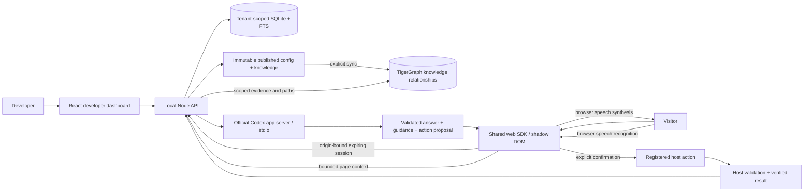

# Architecture

Local deployment is intentional: personal ChatGPT plan credentials remain inside the official local Codex installation. The app-server is a restricted inference process, not a model-controlled browser or shell. No raw credential extraction or paid model API fallback. Public source is separate from a hosted service.

Database: tenants, users, persistent dashboard sessions, agents, draft documents, immutable versions, expiring embed sessions, runs, action receipts. SQL parameters and tenant ownership checks apply at every admin boundary. FTS search is local and needs no embedding key.

Trust boundaries: dashboard cookie/session and same-origin mutations; embed browser to published-public company context; untrusted document/page content to model; model JSON to SDK; SDK to host application. Public embed IDs do not authorize private host mutations. The host remains the authority for its own user and business permissions.
