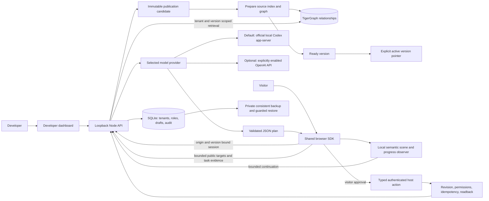

# Architecture

The default deployment stays on loopback. Personal ChatGPT credentials remain in the official Codex installation. The restricted model process cannot browse, invoke tools or operate the filesystem. An optional OpenAI Responses adapter requires explicit provider selection, enablement, model and server credential; there is no fallback between providers. Preparing it does not deploy a public service or enable paid traffic.

Publishing first freezes documents/configuration, then prepares retrieval. A failed candidate leaves the active pointer unchanged. Retry uses the same snapshot; ready versions support activation/rollback. A release epoch prevents a late preparation from overriding a newer publish, rollback or unpublish. Existing visitor sessions keep their pinned version; unpublish prevents new sessions. Schema upgrades preserve original records and convert earlier snapshots into explicitly verified/retryable graph states.

The SDK owns one persistent cursor and an interruptible local renderer. A journey retains its original goal, at most 24 bounded step observations and six automatic continuations. A debounced semantic observer detects dialogs, changed controls and SPA routes; typing values, cursor motion and geometric movement do not trigger inference. Native submit boundaries wait for a host-verified result. Reload resume requires host opt-in, visitor consent and a later explicit Resume choice. Private hosts can collect only reviewed `data-guidekit-id` controls, with generic public labels instead of personal accessible text.

The same SDK serves every company. Public agent IDs select company configuration, knowledge and allowed origins/actions; they never authorize private business operations. Cutroom is a host adapter using its existing authenticated revision/idempotency-aware command API. It excludes media, filenames, account details and private document contents from context. CRM and support remain independent test/demo hosts.

Accounts use Argon2id, persistent HttpOnly sessions, live workspace membership checks and account epochs for revocation. Existing owners migrate without losing login. Invitation/recovery/verification links are hashed, purpose-bound, expiring and single-use; default delivery is a private local outbox. Workspace roles constrain every write. Audit and aggregate latency/failure metrics omit document contents and credentials. Consistent SQLite backups and offline restore guards are separate from graph/model state; see operations guidance for recovery and erasure boundaries.

Trust boundaries are dashboard cookies and exact-origin JSON mutations; visitor bearer sessions and public company context; untrusted knowledge/page content and the model; model JSON and current target/action allowlists; SDK approval and the host's own authorization; and local storage versus external graph/model services. No arbitrary-site, native desktop or canvas interpretation is implied by the website SDK.
