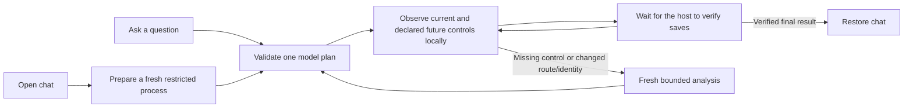

# Fast local guidance

The expensive model should choose a grounded plan. Browser code should follow the user's actual progress through that plan. Re-analyzing every normal panel reveal makes the model's network and inference latency part of every click.

## Changes

- **Keep valid steps.** Added controls or a host render do not discard remaining grounded steps. Unexpected route/control identity changes still invalidate them. Typing values and pointer movement do not trigger model inference.
- **Plan across panels.** Optional `guideTargets` describes up to 64 public controls/16,384 UTF-8 JSON bytes authored by the website developer. The first step must be observed now; later steps may name declared controls. Resolution requires a fresh, unique, safe explicit ID/label/role match. A catalog cannot supply selectors, scripts, file values or action authority. See [SDK configuration](sdk-release.md).
- **Settle briefly.** Relevant new-scene planning waits 120 ms instead of 750 ms after the observer's normal 180 ms settle. Rendering has a bounded 500 ms trailing window and coalesces around asynchronous host context reads. Hard context/route/pause/destroy changes still abort stale work. Typing keeps its intentional 1,200 ms quiet window.
- **Prepare a one-shot runtime.** Connecting an embed or opening its chat can prepare one fresh restricted local Codex process. No prompt, thread, turn or tool starts while idle. It expires after 60 seconds. Claim checks restrictions and ChatGPT identity again, creates one ephemeral thread, performs one inference, then destroys the process. A changed account fails closed; no process or conversation is shared between inferences. Close/cancel/TTL/concurrency have protocol regressions. Cold requests still work when preparation has not finished.
- **Reuse only immutable evidence.** A bounded 32-entry/two-minute cache can reuse validated published evidence inside the exact same trusted tenant, agent, version, embed session, journey and question scope. It never caches page observations, plans or permissions. Refresh failures clear the prior entry and do not use it as fallback.
- **Measure phases.** Optional runtime timing callbacks and the authenticated embed response's `Server-Timing` contain allowlisted duration fields only. They expose no account, prompt, output, credentials or filesystem paths. Prepared request timing excludes work completed before the request.

## Measurements on 2026-11-01

| Evidence | Result | Boundary |
| --- | --- | --- |
| Existing live history, 27 successful requests | Median 13,184 ms; p95 15,892 ms | Server request total, before this change |
| One cold synthetic official subscription request | 11,786 ms | Startup 6,398; catalog 910; model 4,300 ms |
| One prepared synthetic official subscription request | 6,319 ms | Prepared for 12 seconds beforehand; model 6,179 ms |
| Generic released SDK fixture | About 16 ms median local step progress | Five synthetic workflows; one plan per three-step workflow |
| Real Cutroom UI/API, intercepted planning | Title 76.71 ms; canvas 83.39 ms | Panel click to next guide; one model request each |
| Real subscription + TigerGraph + Cutroom | Eight steps, one total model request; initial response 8,342 ms | Separate blank project; title/save/Layout/width/height verified |

The warm and cold runtime values are two diagnostics, not a statistically controlled benchmark. Preparation moves startup earlier. Model service time, network conditions, knowledge retrieval, task size and provider load still vary. New/unplanned branches need fresh analysis. File imports, exports and saves wait for actual host completion; their duration is not hidden by declaring success early.

The live browser proof saved a two-second `Fast Guide` title and changed canvas dimensions to 1920 × 1080. API readback independently confirmed revision 3 and persisted values. The real run retained two knowledge citations and TigerGraph evidence. No existing personal project/media was changed. Runtime evidence stays under ignored `.data/evidence/`; CI uses explicit inference/speech doubles.

## HeyClicky evidence

HeyClicky's [official changelog](https://www.heyclicky.com/changelog) describes answers starting a few seconds after input, remembered screen context, and local visual guidance. Its [public repository](https://github.com/farzaa/clicky) is the older project; current development is private. The supplied engineering investigation identified local retained drawing and browser semantic grounding, but did not measure the current product's private model pipeline or end-to-end latency. Separating model planning from local interaction/rendering is the reconstruction choice used here; exact implementation parity is not established.

## Verification

Run `npm run check`, `npm run test:e2e`, `npm run test:dashboard`, and `npm run test:dashboard:integration`. The core browser command includes the nine latency/catalog/preparation cases in `tests/browser/latency.spec.ts`. Its dedicated config can run them independently. The separate Cutroom checkout has `tests/browser/guidekit-latency.config.ts` for the three host cases and retains its existing workflow suite. Fixtures use disposable databases/projects/media. Live subscription checks are explicit and separate from CI.

## Active Explain measurements — 2026-11-14

The controller now owns distinct listening/finalizing/reading/thinking/presenting phases while public DOM observation stays active locally. The local focus matcher accepts only a uniquely named object in the last acknowledged scene, and adds no inference request. A conceptual explanation still uses inference. The provider can return a compact focus-only response, rehydrated from exact server-validated geometry, instead of regenerating the entire scene. Explain prompts omit irrelevant Guide workflow rules. A new model prefers 4–8 essential objects. The viewer module preloads on Explain activation and stays separate from default Guide startup.

Two real local subscription requests with PostgreSQL evidence produced this diagnostic:

| Phase | New four-object rocket | Same-scene conceptual + focus follow-up |
| --- | ---: | ---: |
| HTTP completion |27,422 ms |7,250 ms |
| Knowledge retrieval |530 ms |288 ms |
| Runtime startup inside request |7,811 ms |0 ms |
| First final-answer delta from inference start |11,134 ms |3,856 ms |
| Full model inference |18,386 ms |5,619 ms |
| Cleanup |28 ms |13 ms |

The follow-up retained identical scene/object geometry and focused the existing engine. The requests were immediate diagnostics rather than a controlled cold/warm benchmark: preparation was requested, but the first worker was not ready, so its startup remained inside the initial request. Timings overlap (first delta is inside inference) and exclude no work by declaring a scene ready early. No partial output or private reasoning was rendered. These samples do not establish p95 or prove an optimization speedup against an equivalent baseline.

Separate live UI verification generated a four-part rocket, exercised orbit/zoom and local Engine focus, then retained that same scene through a conceptual engine follow-up. The visitor confirmed the physical hold-Control microphone flow worked correctly. Browser speech still depends on device/browser support and voice quality is unchanged.

Initial 3D generation is still too slow for a real-time claim. The measured pre-answer wait and output completion both matter; compressing a few default transforms would not address the full delay. Faster model selection, safe progressive scene delivery and a separately enabled hosted provider need measured evaluation before promising lower initial latency. Local established guidance and object focus remain independent of this service time. Private evidence: `.data/evidence/active-explain-final-timing.json` and `active-explain-final.png`.

Final release `dc9beb0e4c8bf9410e1be96b` browser diagnostics measured loaded-module initial presentation at 23.9–43.8 ms, same-scene updates at 18.0–18.3 ms, and local focus acknowledgment at 1.1 ms. Presentation starts after completed response text, immediately before SDK JSON parsing/validation, and ends at the matching committed scene's rendered-frame DOM acknowledgement; it includes validation, rendering and observer delivery, excludes network/model time. Focus ends at actual object selection, excluding camera paint. These are a few synthetic-provider WebGL samples rather than p95/device guarantees. Both rebundled ESM and IIFE npm consumers rendered the scene from the configured trusted endpoint, alongside the direct script installation. Evidence is under `.data/evidence/active-explain-browser-dc9beb0e4c8bf9410e1be96b/`.
