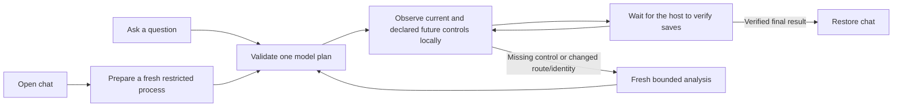

# Fast local guidance

The expensive model should choose a grounded plan. Browser code should follow the user's actual progress through that plan. Re-analyzing every normal panel reveal makes the model's network and inference latency part of every click.

## Changes

- **Keep valid steps.** Added controls or a host render do not discard remaining grounded steps. Unexpected route/control identity changes still invalidate them. Typing values and pointer movement do not trigger model inference.
- **Plan across panels.** Optional `guideTargets` describes up to 64 public controls/16,384 UTF-8 JSON bytes authored by the website developer. The first step must be observed now; later steps may name declared controls. Resolution requires a fresh, unique, safe explicit ID/label/role match. A catalog cannot supply selectors, scripts, file values or action authority. See [SDK configuration](sdk-release.md).
- **Settle briefly.** Relevant new-scene planning waits 120 ms instead of 750 ms after the observer's normal 180 ms settle. Rendering has a bounded 500 ms trailing window and coalesces around asynchronous host context reads. Hard context/route/pause/destroy changes still abort stale work. Typing keeps its intentional 1,200 ms quiet window.
- **Prepare a one-shot runtime.** Connecting an embed or opening its chat can prepare one fresh restricted local Codex process. No prompt, thread, turn or tool starts while idle. It expires after 60 seconds. Claim checks restrictions and ChatGPT identity again, creates one ephemeral thread, performs one inference, then destroys the process. A changed account fails closed; no process or conversation is shared between inferences. Close/cancel/TTL/concurrency have protocol regressions. Cold requests still work when preparation has not finished.
- **Reuse only immutable evidence.** A bounded 32-entry/two-minute cache can reuse validated published evidence inside the exact same trusted tenant, agent, version, embed session, journey and question scope. It never caches page observations, plans or permissions. Refresh failures clear the prior entry and do not use it as fallback.
- **Measure phases.** Optional runtime timing callbacks and the authenticated embed response's `Server-Timing` contain allowlisted duration fields only. They expose no account, prompt, output, credentials or filesystem paths. Prepared request timing excludes work completed before the request.

## Measurements on 2026-11-01

| Evidence | Result | Boundary |
| --- | --- | --- |
| Existing live history, 27 successful requests | Median 13,184 ms; p95 15,892 ms | Server request total, before this change |
| One cold synthetic official subscription request | 11,786 ms | Startup 6,398; catalog 910; model 4,300 ms |
| One prepared synthetic official subscription request | 6,319 ms | Prepared for 12 seconds beforehand; model 6,179 ms |
| Generic released SDK fixture | About 16 ms median local step progress | Five synthetic workflows; one plan per three-step workflow |
| Real Cutroom UI/API, intercepted planning | Title 76.71 ms; canvas 83.39 ms | Panel click to next guide; one model request each |
| Real subscription + TigerGraph + Cutroom | Eight steps, one total model request; initial response 8,342 ms | Separate blank project; title/save/Layout/width/height verified |

The warm and cold runtime values are two diagnostics, not a statistically controlled benchmark. Preparation moves startup earlier. Model service time, network conditions, knowledge retrieval, task size and provider load still vary. New/unplanned branches need fresh analysis. File imports, exports and saves wait for actual host completion; their duration is not hidden by declaring success early.

The live browser proof saved a two-second `Fast Guide` title and changed canvas dimensions to 1920 × 1080. API readback independently confirmed revision 3 and persisted values. The real run retained two knowledge citations and TigerGraph evidence. No existing personal project/media was changed. Runtime evidence stays under ignored `.data/evidence/`; CI uses explicit inference/speech doubles.

## HeyClicky evidence

HeyClicky's [official changelog](https://www.heyclicky.com/changelog) describes answers starting a few seconds after input, remembered screen context, and local visual guidance. Its [public repository](https://github.com/farzaa/clicky) is the older project; current development is private. The supplied engineering investigation identified local retained drawing and browser semantic grounding, but did not measure the current product's private model pipeline or end-to-end latency. Separating model planning from local interaction/rendering is the reconstruction choice used here; exact implementation parity is not established.

## Verification

Run `npm run check`, `npm run test:e2e`, `npm run test:dashboard`, and `npm run test:dashboard:integration`. The core browser command includes the nine latency/catalog/preparation cases in `tests/browser/latency.spec.ts`. Its dedicated config can run them independently. The separate Cutroom checkout has `tests/browser/guidekit-latency.config.ts` for the three host cases and retains its existing workflow suite. Fixtures use disposable databases/projects/media. Live subscription checks are explicit and separate from CI.
