# Observed guidance and local motion

GuideKit remains a company-configured website SDK. The browser adapter supplies bounded public control semantics; the model picks known targets and explanations; local code draws every frame. The October 29 engineering handoff supplied by the owner informs the implementation. It is a reference for recovered parameters, not evidence of measured current HeyClicky parity.

```mermaid
flowchart LR
  Ask[Question or voice shortcut] --> Scene[Bounded public DOM scene]
  Scene --> Reason[Company knowledge + Codex reasoning]
  Reason --> Validate[Typed plan and current target identity]
  Validate --> Beat[Text or actual speech start]
  Beat --> Motion[Retained SVG marks and local cursor]
  Motion --> Observe[Trusted user input and DOM changes]
  Observe --> Verify[Validity, next target, or verified host result]
  Verify --> Next[Next step or restored chat]
  Next --> Beat
```

## Interaction

Chat and its launcher tuck away automatically during a walkthrough. A compact card sits beside the active control. The first editable control can receive focus when the user was in the composer. Automatic advancement moves the visual attention without moving the user's keyboard cursor. Opening chat pauses the same guide; Resume guide restores it. Pause, Back and Automatic progress remain explicit controls. Escape/Stop remove the guide and restore chat.

The observer runs only for the active session. A trusted edit, native validity and 1.2 seconds of quiet complete a single-line field. A real field exit can complete it immediately. Multiline input waits for field exit; composition waits for commit. Native selections/toggles follow their change event. Quickly filled future fields are retained locally so the guide can catch up. It checks readiness, not transmitted field-value content.

Clicking a final submit control is an attempt. The guide waits for `reportStepResult(targetId, { success, message })` after the host saves and independently reads back the result. Without a host integration, Finish guide remains available and explicitly leaves the outcome unverified. This local result callback grants no execution authority and creates no action receipt.

## Drawing contract

Model steps may select `target`, `ring`, `frame`, `arrow`, `underline` or `number`. The server and SDK validate the enum. The renderer receives a known target's live CSS-pixel box, a bounded label/index and a stable mark ID. Model code, selectors and arbitrary coordinates are never executed. Older plans without an annotation use `target`.

Geometry is prepared locally and retains stable seeded variation. The annotation SVG ignores pointer events, allowing the real page to receive clicks. The assistant cursor is a rendered guide, separate from the real pointer. Its pointing, five-bar speaking indicator and waiting spinner remain mounted and crossfade. The bars indicate playback state, not measured microphone amplitude. Scroll/resize immediately update bounds; relevant CSS/WAAPI transitions get bounded frame tracking, then stop. A four-Hz local geometry/identity check during visible active guidance also detects animation that emits no DOM event. The renderer pauses while hidden and respects Reduce Motion; it still follows a moving host target when reduced motion is enabled.

| Parameter | Adapted value | Reference category |
| --- | --- | --- |
| Pen reveal | `clamp(.25 + length/1400, .3, 1.4)` seconds | Current shipped drawing parameters in the supplied handoff |
| Pen easing | `cubic-bezier(.35,.2,.55,.95)` | Current shipped drawing |
| Stroke and glow | 3.5 CSS px; radius 12, opacity .65 | Logical-point parameters adapted to browser CSS pixels |
| Frame opening | .55 seconds | Current shipped drawing |
| Move / erase | .5 / .4 seconds | Current shipped drawing |
| First flight wait | .45 seconds | Current shipped drawing |
| Later travel wait | At distance ≥110: `min(.55,.2+distance/2400)` seconds | Current shipped drawing |
| Cursor flight | `clamp(distance/800,.6,1.4)` seconds, quadratic arc and smoothstep | Older public cursor recipe; exact current flight was unavailable |

Flights use monotonic elapsed time, tangent rotation and a mid-flight scale envelope. Interruptions retarget from the currently sampled presentation. Marks remain local while reasoning is slow; rendering never waits on a per-frame model request.

One narration line is one visual beat. Browser TTS `onstart` releases its marks, rather than the time the speech request was queued. A bounded 2.5-second failure path releases text-mode guidance and cancels stalled narration. New steps, pause, chat, cancellation and destroy invalidate pending beat callbacks. This does not claim phoneme alignment, streaming TTS, or a known future duration from browser speech.

## Grounding and lifecycle

Every reasoning task has a generation and abort signal. Late responses after cancellation or route changes cannot start guidance. Known references are resolved again before presentation and progress: explicit IDs must remain unique and match their captured public role/label; private, hidden or changed controls are rejected. A replacement with the same safe semantic identity can recover within a short grace period. Otherwise chat returns with Refresh guide.

No desktop screen capture, native overlay, OS accessibility traversal, cross-origin iframe reading, canvas interpretation or screenshot fallback is provided by this website SDK. Those require a separately scoped native/extension capability. Existing privacy rules continue to exclude private/payment/password fields and whole-page text. Multi-monitor AppKit transforms and macOS Spaces tests do not apply to this browser implementation.

Browser API references used for implementation: [playback-start events](https://developer.mozilla.org/en-US/docs/Web/API/SpeechSynthesisUtterance/start_event), [host animation tracking](https://developer.mozilla.org/en-US/docs/Web/API/Element/getAnimations), and [SVG stroke reveal](https://developer.mozilla.org/en-US/docs/Web/SVG/Reference/Attribute/stroke-dashoffset). Verification counts, measurements and remaining limits are recorded in [status.md](status.md).
