# Observed guidance and local motion

GuideKit remains a company-configured website SDK. The browser adapter supplies bounded public control semantics; the model picks known targets and explanations; local code draws every frame. The October 29 engineering handoff supplied by the owner informs the implementation. It is a reference for recovered parameters, not evidence of measured current HeyClicky parity.

```mermaid
flowchart LR
  Ask[Question or voice shortcut] --> Scene[Bounded public DOM scene]
  Scene --> Reason[Company knowledge + Codex reasoning]
  Reason --> Validate[Typed plan and current target identity]
  Validate --> Beat[Text or actual speech start]
  Beat --> Motion[Retained SVG marks and local cursor]
  Motion --> Observe[Trusted user input and DOM changes]
  Observe --> Verify[Validity, next target, or verified host result]
  Verify --> Next[Next step or restored chat]
  Next --> Beat
```

## Interaction

The assistant cursor rests in a dock inside the chat header while the visitor asks a question. The same mounted SVG cursor departs from that exact CSS-pixel position when a grounded guide is ready. Chat and its launcher tuck away, and a compact instruction label sits beside the active control while a separate numbered badge identifies it. The first target's stroke waits until the cursor arrives. Opening chat or finishing a guide flies the cursor back into its dock; Resume guide departs from the dock again. Retargeting starts from the currently displayed pose if the user scrolls or changes the guide mid-flight.

The first editable control can receive focus when the user was in the composer. Automatic advancement moves visual attention without moving the user's keyboard cursor. Opening chat pauses the same guide; Resume guide restores it. Pause/Resume, chat and stop are the guide's only controls; there are no Back, Next, Finish or automatic-mode buttons. Escape/Stop remove the guide and restore chat. The dock follows panel entrance, resize and viewport changes, while a paused guide yields renderer ownership to chat so host mutations cannot interrupt the return flight.

## Guided scrolling

A newly grounded step reveals its control before cursor flight, drawing or spoken narration. The local controller checks the visual viewport and clipping ancestors, then moves the required scrollable panels and document with a smooth acceleration/braking curve. Already visible controls remain in place with no reveal delay. The nearest clipped edge receives a comfortable margin; author-supplied `scroll-padding` and target `scroll-margin` preserve room for sticky headers and panel chrome. Nested panels are handled independently of the document's scroll position.

One reveal owns a bounded animation, revalidating the safe control identity each frame. It remeasures after settling before allowing the existing cursor and pen sequence to run. Only a new step, replacement control or explicit Resume can request another reveal; layout observations do not repeatedly pull a visitor back after manual scrolling. Wheel, touch movement, page-navigation keys and a click on the host interrupt the animation. Pause, chat, stop, Escape, hidden pages and destroy cancel its work. A paused reveal can be explicitly resumed. Reduced Motion applies the required scroll instantly and keeps the existing static presentation behavior.

Scrolling uses public target geometry only, makes no model request and does not edit or submit the host. Offscreen or clipped targets receive no stale drawing or narration. Source visibility/privacy and host authorization rules remain unchanged. Hosts should declare sticky offsets using CSS scroll padding instead of relying on header guessing; see [scroll padding](https://developer.mozilla.org/en-US/docs/Web/CSS/Reference/Properties/scroll-padding-top) and [the visual viewport](https://developer.mozilla.org/en-US/docs/Web/API/VisualViewport).

## Spatial instruction label

A compact warm amber label carries the instruction next to the target. The requested ring, frame, arrow, underline or target mark remains visible alongside an independent numbered badge. Pause/Resume, chat, stop and Show full instruction live in a separate small control strip, with the current step count. Ordinary guidance has no persistent panel header, progress bar, navigation footer or generic hint paragraph. Pending host verification, failure, paused and missing-target states remain available automatically.

After scrolling settles, the cursor flies to the control and its target stroke completes. Only then does the label reveal one complete Unicode grapheme at a time. The typewriter uses a natural local cadence with small punctuation pauses; a delayed frame can append only the next grapheme, never a catch-up word or chunk. Long instructions take proportionally longer and remain skippable. The real visible prefix drives width and height, up to 320 CSS pixels constrained by the visual viewport. Text writes and geometry measurements have separate clocks: measurement is coalesced to approximately 40-ms intervals. Bounds retarget smoothly without scaling glyphs. Sixteen placement candidates penalize overlap with the target, badge, toolbar and bounded known public controls. Candidate obstacles are clipped to their visible safe bounds; public control identities are revalidated. Long text wraps and retains native overflow on small screens.

This effect presents an already validated instruction locally. It adds no model request and never delays observed user progress or a verified host result. Same-step observations and geometry refreshes do not replay it. **Show full instruction** finishes the visual reveal. Pause, chat and document hiding finish current text and suspend the relevant animation; Resume does not replay it. Step replacement and destroy invalidate pending work. Reduced Motion shows the settled scene and complete instruction immediately. Browsers without `Intl.Segmenter` also receive complete text immediately.

Decorative typing and the numbered badge are hidden from assistive technology. A separate atomic polite live region receives the complete step number and instruction once per step. These semantics are browser-tested; physical screen-reader behavior remains a separate device check. See [Unicode grapheme segmentation](https://developer.mozilla.org/en-US/docs/Web/JavaScript/Reference/Global_Objects/Intl/Segmenter) and [ARIA live regions](https://developer.mozilla.org/en-US/docs/Web/Accessibility/ARIA/Reference/Attributes/aria-live). Reference evidence and its limits are documented in [spatial-guidance.md](spatial-guidance.md).

The observer runs only for the active session. A trusted edit, native validity and 1.2 seconds of quiet complete a single-line field. A real field exit can complete it immediately. Multiline input waits for field exit; composition waits for commit. Native selections/toggles follow their change event. Quickly filled future fields are retained locally so the guide can catch up. It checks readiness, not transmitted field-value content.

A valid native dropdown can retain its current choice when the visitor deliberately Tabs or clicks into another safe page control. This requires the same trusted gesture and focus-exit task; focus alone, programmatic focus/blur, invalid values, GuideKit chrome and paused guidance cannot accept a default. This rule does not treat an unchanged checkbox or radio as completed.

Clicking a final submit control is an attempt. The guide waits for `reportStepResult(targetId, { success, message })` after the host saves and independently reads back the result. Without a host confirmation it must explain that the result is unverified; it never treats animation completion as a successful save. Unsupported custom controls need observable native events or an explicit host result, and the visitor can open chat or stop at any point. This local result callback grants no execution authority and creates no action receipt.

## Drawing contract

Model steps may select `target`, `ring`, `frame`, `arrow`, `underline` or `number`. The server and SDK validate the enum. The renderer receives a known target's live CSS-pixel box, a bounded label/index and a stable mark ID. Model code, selectors and arbitrary coordinates are never executed. Older plans without an annotation use `target`. Indexed steps compose a separate 22-CSS-pixel numbered badge with the requested mark; `number` uses the target corners plus that badge. The badge stays outside the target-scaled SVG group, preserving target geometry and pointer-through behavior.

Geometry is prepared locally and retains stable seeded variation. The annotation SVG ignores pointer events, allowing the real page to receive clicks. The assistant cursor is a rendered guide, separate from the real pointer. Its pointing, five-bar speaking indicator and waiting spinner remain mounted and crossfade. The bars indicate playback state, not measured microphone amplitude. Scroll/resize immediately update bounds; relevant CSS/WAAPI transitions get bounded frame tracking, then stop. A four-Hz local geometry/identity check during visible active guidance also detects animation that emits no DOM event. The renderer pauses while hidden and respects Reduce Motion; it still follows a moving host target when reduced motion is enabled.

| Parameter | Adapted value | Reference category |
| --- | --- | --- |
| Pen reveal | `clamp(.25 + length/1400, .3, 1.4)` seconds | Current shipped drawing parameters in the supplied handoff |
| Pen easing | `cubic-bezier(.35,.2,.55,.95)` | Current shipped drawing |
| Stroke and glow | 3.5 CSS px; radius 12, opacity .65 | Logical-point parameters adapted to browser CSS pixels |
| Frame opening | .55 seconds | Current shipped drawing |
| Move / erase | .5 / .4 seconds | Current shipped drawing |
| First flight wait | At least .45 seconds and until actual cursor arrival | .45-second source parameter; arrival gating adapts it to dock departure |
| Later travel wait | At distance ≥110: `min(.55,.2+distance/2400)` seconds | Current shipped drawing |
| Cursor flight | `clamp(distance/800,.6,1.4)` seconds, asymmetric cubic path with a perpendicular bow, eased departure and soft landing | Original GuideKit reconstruction informed by the published reference; exact current native flight remains unmeasured |
| Guided scroll | 280–780 ms, distance-based quintic easing; at most three layout corrections within 2.3 seconds | GuideKit browser interaction design; runs before cursor flight |

Flights use monotonic elapsed time, bounded heading bank and a subtle scale envelope. The sideward bow remains visible for horizontal, vertical and diagonal journeys, and the cursor settles precisely at its destination. Interruptions retarget from the currently sampled position, angle and scale. Marks remain local while reasoning is slow; rendering never waits on a per-frame model request.

One narration line is one visual beat. Browser TTS `onstart` releases its marks, rather than the time the speech request was queued. A bounded 2.5-second failure path releases text-mode guidance and cancels stalled narration. New steps, pause, chat, cancellation and destroy invalidate pending beat callbacks. This does not claim phoneme alignment, streaming TTS, or a known future duration from browser speech.

## Grounding and lifecycle

Every reasoning task has a generation and abort signal. Late responses after cancellation or route changes cannot start guidance. Known references are resolved again before presentation and progress: explicit IDs must remain unique and match their captured public role/label; private, hidden or changed controls are rejected. A replacement with the same safe semantic identity can recover within a short grace period. Otherwise chat returns with Refresh guide.

No desktop screen capture, native overlay, OS accessibility traversal, cross-origin iframe reading, canvas interpretation or screenshot fallback is provided by this website SDK. Those require a separately scoped native/extension capability. Existing privacy rules continue to exclude private/payment/password fields and whole-page text. Multi-monitor AppKit transforms and macOS Spaces tests do not apply to this browser implementation.

Browser API references used for implementation: [playback-start events](https://developer.mozilla.org/en-US/docs/Web/API/SpeechSynthesisUtterance/start_event), [host animation tracking](https://developer.mozilla.org/en-US/docs/Web/API/Element/getAnimations), and [SVG stroke reveal](https://developer.mozilla.org/en-US/docs/Web/SVG/Reference/Attribute/stroke-dashoffset). Verification counts, measurements and remaining limits are recorded in [status.md](status.md).
