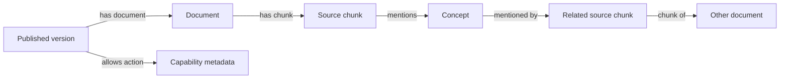

# TigerGraph knowledge relationships

TigerGraph is GuideKit's server-side relationship retrieval integration, selected for the sponsor demonstration. It augments the planner's document evidence: a question matches concepts in source chunks; those chunks expose other concepts; shared concepts lead to additional documents. For example, asking about an **invoice** can retrieve a **statement export** document via their shared **billing** concept even when that second document never says “invoice.” The returned paths explain the connection. The original excerpts remain the evidence for facts; a relationship is not proof of a policy.

The implementation is in `packages/graph/src/index.ts`; the schema and installed queries are in `packages/graph/gsql/`. There are no additional runtime dependencies. Import this package only from the Node server. The browser SDK must never receive the TigerGraph token.



Every vertex stores tenant, agent, version and a scope hash. Every ID includes that scope; concepts are never shared across tenants or published versions. Queries check scope at every hop and verify source-document membership in a ready version. The client independently rejects evidence outside its requested scope. The authenticated server must derive scope from its trusted session and published snapshot, never from a visitor's model output.

Concepts are deterministic, normalized lexical terms, with stop words removed; this does not claim semantic embeddings or LLM extraction. Each 900-character chunk links to at most 24 concepts, including title terms. Retrieval expands at most 32 seed chunks and 256 bridge concepts, selects one candidate chunk per document, and returns at most 16 source documents with up to eight explanation tuples per chunk. A document's earliest candidate chunk supplies its excerpt. Action vertices snapshot the published allowlist for graph inspection; they confer no execution permission. The host still validates and confirms actions.

## Cluster setup

No TigerGraph cluster, account, token or paid service is provisioned automatically. An administrator needs access to a compatible TigerGraph deployment and GSQL/GraphStudio schema/query installation. The supplied files target the documented GSQL v2 syntax and RESTPP interfaces. The schema and all three queries were compiled and installed successfully on TigerGraph Savanna 4.2.5 on 2026-10-29. Live synthetic sync and retrieval verified the invoice → billing → statement-export relationship, idempotent sync, tenant isolation and published-version isolation. Other deployment versions still need compatibility verification.

1. Use a dedicated development database/cluster or a new graph namespace. Inspect existing vertex and edge type names first: the schema creates `GK*` types. If those names or `GuideKit` already exist, stop and inspect the existing schema. The schema contains no `DROP` or replacement commands. Query installation uses `CREATE OR REPLACE QUERY`; inspect any existing `guidekit_*` queries before replacing them.
2. Review `packages/graph/gsql/schema.gsql`, then execute it through your deployment's GSQL client or schema editor. The default graph name is `GuideKit`. If a different name is required, replace the graph identifier consistently in both GSQL files and in server configuration. Do not replace tenant or agent IDs in the schema.
3. Execute `packages/graph/gsql/queries.gsql` in GSQL. It creates and installs `guidekit_status`, `guidekit_version` and `guidekit_retrieve`. Query installation must report success; merely pasting the source does not install the REST endpoints. The status query returns schema marker `1`.
4. Create a dedicated runtime identity/token with only the privileges needed to execute these installed queries and upsert data in this graph. The schema administrator's credentials should not be the application's runtime identity. Follow the deployment's authentication procedure and keep its token in server-only configuration.
5. Configure the server origin, graph name, token and RESTPP prefix. For the standard HTTPS gateway use `/restpp`; for a direct local RESTPP listener at port 9000 use an empty prefix. Verify the URL in the deployment's documented/copyable query endpoint. Do not guess by adding prefixes repeatedly.

The local server loads `.env` with `npm start` and `npm run dev`. Set `TIGERGRAPH_BASE_URL` and exactly one of `TIGERGRAPH_SECRET` (Savanna) or `TIGERGRAPH_TOKEN` (bearer token). The former uses the documented `Authorization: GSQL-Secret` header; credentials remain server-only. A Savanna database secret does not expire and has its user's workspace privileges; use a restricted identity for hosted deployments.

Dashboard → Install shows actual connection status and an explicit **Sync published version to TigerGraph** button. Sync after every publication. The server reads the immutable saved version, and new questions use graph evidence exclusively while configured. An unavailable or unsynced configured graph produces an error instead of silently switching retrieval providers. The SDK displays returned relationship paths.

The provider configuration is explicit:

```ts
import { createTigerGraphProvider } from '../packages/graph/src/index.js';

const graph = createTigerGraphProvider({
  baseUrl: process.env.TIGERGRAPH_BASE_URL!, // origin only: https://cluster.example
  graphName: process.env.TIGERGRAPH_GRAPH_NAME ?? 'GuideKit',
  secret: process.env.TIGERGRAPH_SECRET, // Savanna database secret
  // Alternatively token: process.env.TIGERGRAPH_TOKEN (set exactly one credential)
  restppPrefix: process.env.TIGERGRAPH_RESTPP_PREFIX ?? '/restpp'
});
const status = await graph.status();
```

The parent server owns environment loading; the library itself reads no environment variables. Pass no configuration to represent an unconfigured provider. Partial configuration should be treated as a server configuration error. Only HTTPS origins are accepted remotely; HTTP is allowed for loopback local clusters. Origins cannot contain credentials, paths, queries or fragments. `restppPrefix` supplies the explicit path separately. Graph names must be GSQL identifiers.

## Publish and retrieve

Call `syncVersion` with the tenant's immutable published document snapshot and allowed action names. Synchronize the saved version, not mutable draft documents. Existing content under the same tenant/agent/version has a manifest hash: repeating an identical snapshot is idempotent; changing one raises a conflict and requires a new published version. Concurrent identical syncs within a provider instance share one operation. The application must serialize publication per version and use one trusted publisher; the REST upsert protocol is not a distributed compare-and-swap lock across multiple server processes.

Vertices and then edges are upserted in bounded batches. The client requests `ack=all` and `vertex_must_exist=true`, checks acknowledged counts, and marks the version `ready=true` only after all batches succeed. Failed or incomplete versions cannot provide retrieval evidence. Retry the same immutable snapshot to recover; do not overwrite it with a draft. No automatic graph deletion or historical-version cleanup runs.

```ts
await graph.syncVersion({
  tenantId: published.tenantId,
  agentId,
  version: published.version,
  documents: published.documents,
  allowedActions: published.config.allowedActions
});
const evidence = await graph.retrieve({
  tenantId: published.tenantId, agentId,
  version: published.version, question: visitorMessage, limit: 8
});
// Supply evidence.citations and evidence.paths to the planner as untrusted reference data.
// Citation documentIds must still be validated against this published snapshot.
```

All requests are POSTs. With the default prefix, the exact paths are `/restpp/graph/GuideKit?ack=all&vertex_must_exist=true` for upsert and `/restpp/query/GuideKit/{query_name}` for installed queries. Query parameters are JSON fields, including a primitive array for the `SET<STRING>` terms parameter. The provider sets a six-second server query timeout, an eight-second local abort timeout, disables redirects, and caps response bytes. HTTP errors, TigerGraph's `error:true`, malformed responses, partial acknowledgement and transport failure all produce errors. They never return invented evidence or silently substitute another provider. Status failure reports `configured:true, connected:false` with a sanitized message.

## Verification boundary

Run the provider contract tests with:

```sh
node --import tsx --test packages/graph/tests/*.test.ts
npm run typecheck
```

These unit tests use an explicit in-memory REST fixture. They exercise graph upsert shape, shared-concept traversal to a document lacking the question token, tenant/agent/version isolation, immutable snapshot conflict, retry after incomplete sync, exact gateway/direct paths, response scope checks and sanitized failures. They do not prove GSQL compilation, cluster availability, token authorization or live retrieval.

After installing the queries and configuring real credentials, first check `status().connected`. Then publish a synthetic two-document snapshot containing the invoice/billing/export example and call `retrieve` for `invoice`; verify both source excerpts and the `invoice → billing → export` document/concept/document path. Repeat against a second tenant and a later version and confirm their sources never appear in the first scope. Finally verify those returned excerpts and paths reach a real planner request and its answer cites the correct published source. Only then mark the provider live connected and end-to-end verified.

Official references used for the implementation: [REST upsert and acknowledgement](https://www.tigergraph.com/docs/tigergraph-server/4.2/api/upsert-rest), [installed RESTPP query endpoints](https://www.tigergraph.com/docs/tigergraph-server/4.2/api/built-in-endpoints), [GSQL v2 traversal](https://www.tigergraph.com/docs/gsql-ref/4.2/querying/select-statement/from-clause-v2), [accumulators](https://www.tigergraph.com/docs/gsql-ref/3.10/querying/accumulators), [output projections](https://www.tigergraph.com/docs/gsql-ref/4.1/querying/output-statements-and-file-objects), and [REST time and response limits](https://www.tigergraph.com/docs/tigergraph-server/3.10/api/).

Opt-in live verification: `npm run test:graph` uses only synthetic documents and the configured workspace. It retains its uniquely scoped proof vertices so evidence can be inspected; it never drops application data.

Savanna references: [data-plane authentication and workspace endpoints](https://www.tigergraph.com/docs/savanna/main/rest-api/data-plane-apis), [query creation and replacement](https://www.tigergraph.com/docs/gsql-ref/4.1/querying/query-operations).
