# viaSocket integration assessment

Assessed on 2026-10-29. Status: suitable optional provider; no connection or live action implemented.

## Role in GuideKit

viaSocket supplies connections and actions for external apps. Its developer API handles service discovery, per-user app connection, action schemas/options and execution. Its embedded product can expose connection/workflow screens inside a dashboard. This complements GuideKit's company knowledge, visual guidance and permission-aware host actions.

One useful first integration is creating a support ticket in a company-connected service. Keep the existing browser-native and Cutroom-specific commands on their own host adapters.

```mermaid
flowchart LR
  Visitor[Authenticated website user] --> Request[GuideKit action proposal]
  Request --> Approval[Review and approve]
  Approval --> Host[Host backend: authorize + validate + deduplicate]
  Host --> Provider[viaSocket server-side API]
  Provider --> App[Company-connected support service]
  App --> Verify[Verify remote ticket ID and status]
  Verify --> Receipt[GuideKit outcome receipt]
```

## Prerequisites and boundaries

- A viaSocket project supplies org ID, project ID and signing secret. Keep the secret server-side; sign scoped tokens for connection setup.
- Derive a stable connection identity from authenticated tenant/user state. An anonymous public embed session or browser-supplied identity cannot select an account or grant permissions.
- Connect an app through its authorization flow. Persist its auth_id and enabled script_id against the trusted identity/service mapping. The execution script_id is itself a credential, not a public identifier.
- Resolve real service/action IDs and account-specific destination options from the provider; do not let a model invent or select arbitrary connection IDs/URLs.
- Implement a narrow registered host action that invokes the authenticated host backend. Retain GuideKit's argument validation, allowed-action list, explicit confirmation, idempotency key and verified outcome receipt.
- Keep the existing Codex planner restricted. The API adapter can perform approved work outside the model process; enabling unrestricted MCP tools is unnecessary.
- Keep remote response details private. Return only the bounded result needed by the visitor and store reference IDs for reconciliation.
- Multi-step workflow exposure is not evidence of a database transaction, rollback, remote cancellation or end-to-end idempotency. Verify those behaviors per connector before retrying mutations automatically. An ambiguous timeout needs reconciliation.

## Core scope

The present core already runs without this provider. Add one real connector after project access and an explicit authorized test account are available; verify per-user isolation, approval, denied access, timeout handling and the resulting remote record before expanding the catalog. Do not replace GuideKit's SDK, knowledge retrieval, local authentication, inference or visual overlays with provider features.

No viaSocket SDK has been installed and no provider credentials, telemetry or remote actions were sent during this assessment. Pricing and account entitlement must be confirmed before selecting a plan.

## Official sources

- [Developer quickstart](https://viasocket.com/developers/docs): project credentials, stable end-user identity, connection setup, action discovery/execution, and script_id handling.
- [Actions for AI](https://viasocket.com/help/viasocket-embed/types-of-embed/-actions-for-ai-): connected app actions and user-built workflows exposed as tools.
- [Embedded app integration](https://viasocket.com/embed/app-integration): embeddable connection/workflow screens and sandbox plan information.
